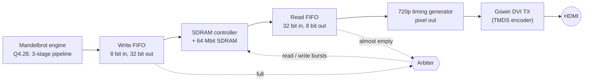

# FPGA Mandelbrot Zoom – 720p over HDMI on a Tang Nano 20K

A continuously zooming Mandelbrot set, computed **entirely in hardware** (no CPU, no soft core) and shown at **1280×720 @ 60 Hz** over HDMI. Every pixel is calculated by a fixed-point iteration engine on the FPGA, stored in the on-package SDRAM and streamed out to the monitor.

[Zooming Mandelbrot Gif](MandelbrotZooming.gif)

## Highlights

- **Fixed-point arithmetic**, Q4.28 (32 bit), 3-stage pipelined iteration using the DSP multipliers
- **Full-resolution framebuffer in SDRAM** (1280×720×8 bit), written by the compute engine and read independently by the video output
- **Single 74.25 MHz clock** for everything, with a 371.25 MHz serial clock for the TMDS encoder
- **Automatic zoom** into Seahorse Valley: exponential zoom, one step per finished frame
- Written in Verilog, built with Gowin EDA

## Hardware and tools

| | |
|---|---|
| Board | Sipeed Tang Nano 20K |
| FPGA | Gowin GW2AR-LV18QN88PC8/I7 (with 64 Mbit SDRAM in the package) |
| Tool | Gowin EDA V1.9.12.04 |
| Output | HDMI, 1280×720 @ 60 Hz |

## Architecture

### Clocks

The 27 MHz oscillator feeds a PLL that produces 371.25 MHz. A clock divider (÷5) gives 74.25 MHz, which is exactly the 720p60 pixel clock. The compute engine, the FIFOs, the SDRAM controller and the video timing all run on that 74.25 MHz clock. The 371.25 MHz clock only drives the serializers of the HDMI encoder.

### Compute engine

One pixel is computed at a time by a small state machine that iterates `z ← z² + c` until `|z|² > 4` or the iteration limit is reached.

- **Number format:** Q4.28 signed fixed point (4 integer bits including sign, 28 fractional bits). The format is parameterised (`F`, `W = F + 4`).
- **Pipeline:** each iteration takes 3 clocks: registered products (`zx²`, `zy²`, `zx·zy` in three 36×36 multipliers), then the new `z` and `|z|²`, then the escape test. This is what lets the 32-bit multipliers meet timing at 74.25 MHz.
- **Escape test:** the squares are kept at full width for the `|z|² > 4` check, so it can't wrap around.
- **Pixel coordinates:** `c = corner + pixel · step` is generated with running adders (no multiplier): add `step` per pixel, and reload from the corner at the end of a row.
- **Output:** the iteration count is turned into an 8-bit grey value (repeating bands); points that never escape are black.

### Framebuffer path (SDRAM)

The frame is 1280×720 pixels at 8 bit, which is 230,400 32-bit words. Four pixels are packed into each word.

- **Write side:** finished pixels go into an 8→32 bit FIFO. When it is full, the arbiter writes a burst of 64 words (256 pixels) to the SDRAM. A frame is exactly 3600 bursts.
- **Read side:** a 32→8 bit FIFO (first-word fall-through) feeds the video output at one pixel per clock. When it runs low, the arbiter reads the next burst of 64 words.
- **Arbiter:** a small FSM with read priority (the display must never starve). It only issues a command when the controller reports idle, and waits for the controller's acknowledge.
- **Frame sync:** once per frame, in the middle of vertical blanking, the read FIFO is reset and the read address is set back to 0, so the display always starts a frame on pixel 0.

The compute engine is much slower than the display, so the monitor shows the frame buffer *while it is still being rewritten*. You can see the new zoom level sweep down over the old one (no double buffering, on purpose).

### Video output

A 1650×750 counter pair generates the standard 720p60 timing (hsync, vsync, data enable) and drives the Gowin DVI/HDMI TX encoder with the pixel read from the FIFO.

### Zoom control

- The view is defined by a centre point and a **step** (distance between neighbouring pixels in the complex plane). The top-left corner is computed from both.
- After each finished frame the step shrinks by 1/8 (`step -= step >> 3`), which gives a constant relative zoom speed. At the minimum step it starts over.
- The step only changes between frames, so one frame never mixes two zoom levels.
- Frame time depends on the view: a few seconds per frame, because every point inside the set costs the full iteration limit.

## Parameters (top of `mandelbrot.v`)

| Parameter | Meaning |
|---|---|
| `F`, `W` | Fractional bits and total width of the fixed-point format (`W = F + 4`) |
| `CX`, `CY` | Zoom target, pre-scaled by 2^F (default: −0.743643887037151 + 0.131825904205330i) |
| `STEP0` | Starting pixel spacing (smaller = more zoomed in) |
| `MIN_STEP` | Spacing at which the zoom restarts (≈ `STEP0 / max zoom`) |
| `ZOOM_SHIFT` | Zoom speed: step shrinks by `1 / 2^ZOOM_SHIFT` per frame |
| `MAX_ITER` | Iteration limit |
| `TEST_MODE` | Writes a simple test pattern instead of the Mandelbrot set (for debugging the memory path) |

## Build and run

1. Open the project in Gowin EDA with device `GW2AR-LV18QN88PC8/I7`.
2. The generated Gowin IP is needed: rPLL (27 MHz → 371.25 MHz), the two FIFOs, the SDRAM controller (embedded SDRAM version) and the DVI TX.
3. Synthesize, place and route, then program the board over USB.
4. Connect HDMI. A 720p60 monitor or TV is enough.

## Results

- **Timing:** `clk_medium` (74.25 MHz) closes with a maximum frequency of about 83.790 MHz, so enough slack.
- **DSP:** 3× `MULT36X36` and 1× `MULTALU36X18`.
- **Zoom range:** about 1000× by default. Roughly 20,000× is possible with the current format before rounding noise appears; more needs more fractional bits and a higher iteration limit.

## Things I ran into

- **DSP register absorption:** the synthesis tool pulled the `z` registers into the DSP blocks, which gave a wedge-shaped, distorted image on hardware. Marking `zx`/`zy` with `syn_preserve` kept them as normal registers.
- **Escape test overflow:** `|z|²` can exceed the range of the `z` format, so the escape check uses a wider, non-wrapping value.
- **SDRAM burst length:** the controller transfers `data_len + 1` words. Setting `data_len = 64` made every burst 65 words long, which skewed the picture by 20 pixels per row. The correct value for 64 words is 63.
- **FIFO flags:** `Almost_Empty` goes low again when the FIFO is completely empty, so the arbiter has to check `Empty` as well, or it stalls.
- **Stale FIFO contents at frame start:** the read FIFO prefetches across the frame boundary, so the read address and the FIFO have to be reset together. This is done in vertical blanking.
- **Timing margin:** `clk_medium` closes at a 74.25 MHz target with Fmax 83.8 MHz (about 1.5 ns of slack, 11% of the clock period). The critical path is not in the compute engine. It runs from the read FIFO's block RAM output through the `DE` gate into the Gowin TMDS encoder. Registering `pixel_from_fifo`, `DE` and the sync signals would shorten it, but the slack is enough for now.

## Next step (not implemented): pixel interleaving

**Problem:** The compute loop (PROD → ADD → CHECK) handles one pixel at a time.
The multipliers sit idle about 2/3 of the time.

**Idea:** Keep several independent pixels in flight. Each pixel's iteration only
depends on itself, so with 3 pixels in rotation a new product can start every
cycle: up to ~3x throughput with no extra DSPs.

**Design sketch**
- Register arrays for `zx, zy, cx, cy, iter` (one entry per pixel in flight)
- A rotating index selects which pixel enters the multipliers each cycle, and
  travels down the stages as a tag so results go back to the right entry
- Replace the FSM with free-running stages (every stage works every cycle)

**Main challenge, output ordering:** Pixels finish after different iteration
counts, but the framebuffer is written in raster order. A finished pixel could
wait until it is the oldest one in flight.

## Credits

The HDMI (DVI TX), PLL, FIFO and SDRAM controller blocks are Gowin IP, generated with Gowin EDA. Everything else (compute engine, framebuffer arbiter, video timing, zoom control) is my own Verilog.
